# DigDice

**Dwarves and dice.** A first-person dice game where the dice are blocks in the world: you dig them out, carry them, and build poker hands with them.

> [!NOTE]
> This is the public write-up for a private repository. DigDice is in active development and headed for Steam. Rules, numbers and looks here will keep changing until it ships.

  

## What it is

You are a dwarf on a small voxel map with one, three or seven other dwarves. Dice are set into the walls and lying about the field. Standing here and there are **shrines**: groups of frosted-glass ghost dice, each group asking for one hand (a pair, a straight, three of a kind, a sum of 8).

- **Dig.** Swing at a die until it breaks loose, then walk over it to pick it up.
- **Carry.** Your tray holds six things. Dice, stone, ladders and modifiers all compete for the same six slots.
- **Answer a shrine.** Place real dice into the ghosts. When the hand is complete the shrine pays out, all of it, to whoever placed the last die.
- **Whack.** Hit another dwarf and a die falls out of their tray.

A round is five minutes, and the highest score wins. The whole game plays on five keys: the four arrows and `SPACE`.

<table>
  <tr>
    <td width="50%"></td>
    <td width="50%"></td>
  </tr>
  <tr>
    <td>Dig: a four, cracking loose.</td>
    <td>Whack: stars, and dice knocked loose.</td>
  </tr>
</table>

## Why

The question I asked myself with this project was: **what would a dice game look like if it were a first-person dungeon crawler?**

It did not start with dice. It started as an engine experiment (a discrete voxel grid with a smooth first-person view, generated entirely from a seed) and went looking for a game:

- **Letters first.** First-person Scrabble: mine letter tiles, spell words in the world. Long words are very hard to see from inside a corridor, and the scoring has too many possibilities to read at a glance.
- **Cards.** 52 of them before any jokers, and unreadable at a distance on a 32×32-texel block face.
- **Dice.** Six faces, each legible as pips at any size, and a small set of hands most people already know.

Dice brought a second problem. In a dice game the fun is watching a hand score, but in first person you only ever see the corridor you are standing in. A scoring engine spread across the map does its work where nobody is looking. Shrines are the answer to that: a hand is asked for at a *place*, you stand in front of it to finish it, and it pays out in front of you. The world stops being storage and becomes the board.

<table>
  <tr>
    <td width="50%">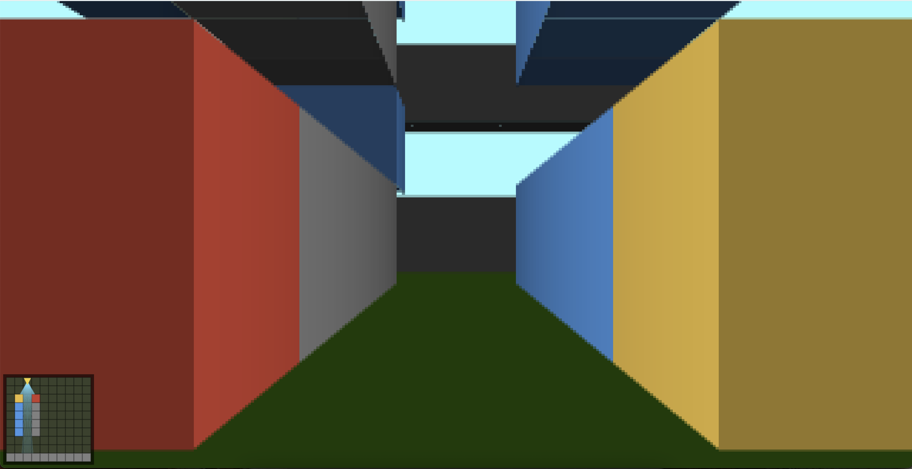</td>
    <td width="50%">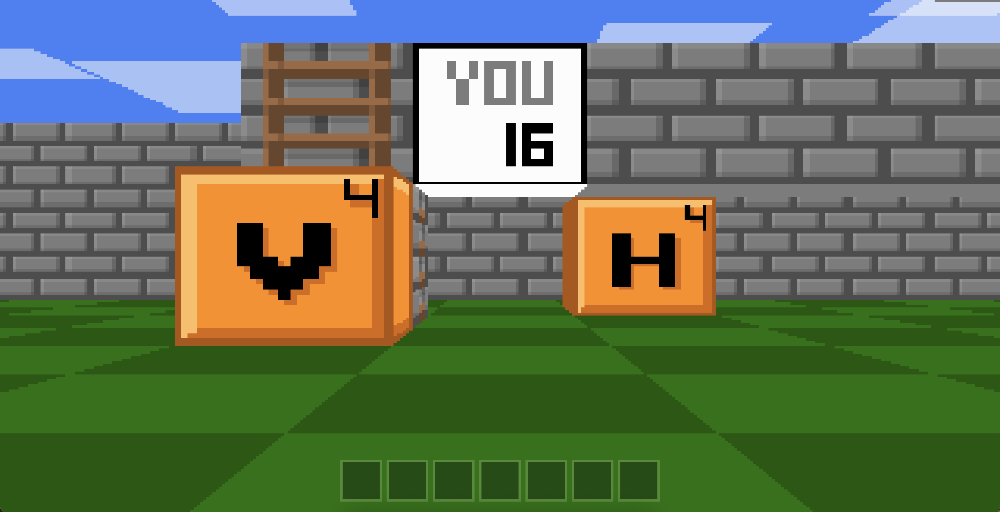</td>
  </tr>
  <tr>
    <td>Day 2: an engine with nothing to do.</td>
    <td>Day 10: the word game, the day before the letters became dice.</td>
  </tr>
</table>

## How a round plays

  

**Everyone hatches.** Each round starts with every dwarf in an egg at their spawn. The clock starts once they are out. Get whacked with an empty tray and you are back in an egg for three seconds.

**Shrines ask, dice answer.** A fixed shrine shows the pips each ghost wants. An open one shows `?` and takes any dice that make its hand. Face a ghost and press `↑` to check it: the hotbar turns into the shrine's hand, its ghosts, and what it would pay.

   
  Four of a Kind, stacked four high: up to 300.

**Height pays.** A shrine scores like a word in Scrabble: each die's pips × its level premium, added up, × the hand's multiplier. The premium is ×1 on the ground, ×2 a level up, ×3 two up. A pair of 4s on the ground pays (4 + 4) × 2 = 16. Stack them and it pays (4×1 + 4×2) × 2 = 24. So the best shrines are the ones you have to build up to.

| Hand | Multiplier | Example |
| --- | --- | --- |
| High Die | ×1 | `5` |
| Pair | ×2 | `3 3` |
| Three of a Kind, Tiny Straight, All Odd, All Even, Two Pair | ×3 | `4 4 4` |
| Small Straight, Full House | ×4 | `2 3 4 5` |
| Four of a Kind, Large Straight | ×5 | `5 5 5 5` |
| Five of a Kind, Full Straight | ×6 | `1 2 3 4 5 6` |
| Snake Eyes | ×12 | `1 1` |

   
  A Small Straight stacked four high: (3×1 + 4×2 + 5×3 + 6×4) × 4 = 200.

**Everything is a block.** Stone, four ores, ladders, chests, the CRAFT bench and the EXIT door can all be mined, carried and put down somewhere else. Carry off a bench and nobody else can craft at it. Ores craft into four modifiers that work while they sit in your tray: **Strength** (dig and whack harder), **Speed**, **Sight** (stand still to X-ray dice and shrines through walls) and **Luck** (roll a loose die). Every slot spent on one is a slot that cannot hold a die.

  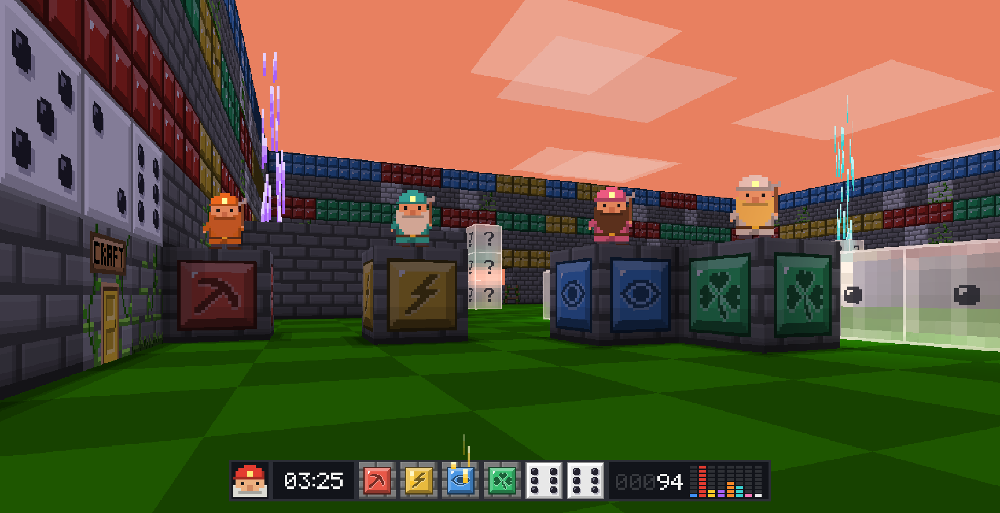

<table>
  <tr>
    <td width="50%">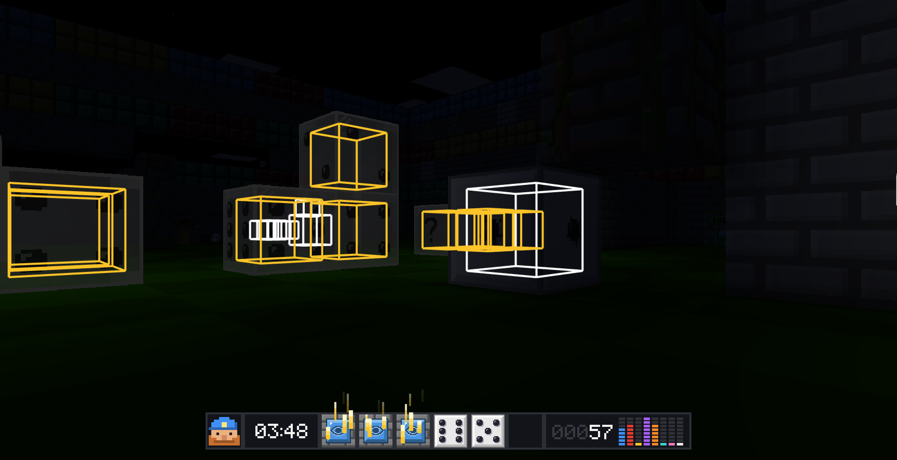</td>
    <td width="50%"></td>
  </tr>
  <tr>
    <td>Sight: stand still, and nearby dice and shrines show through the walls.</td>
    <td>Luck: face a loose die and roll it until it shows what you need.</td>
  </tr>
</table>

  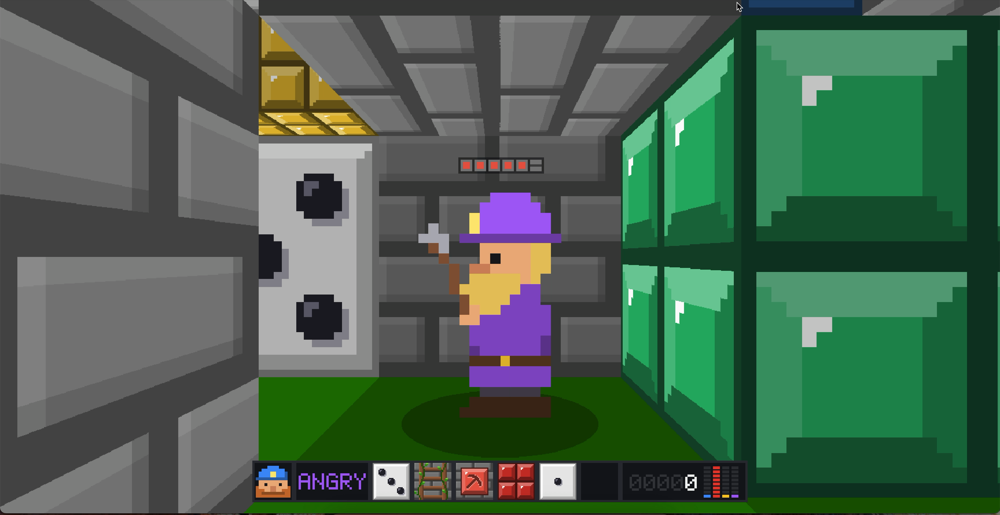 
  Angry, who is about to whack you.

**Then the board.** When the clock runs out, the scoreboard comes up a row at a time from last place, the winner last.

  

## The dwarves

The other seats are played by bots: eight dwarves, A to H, one for every way to play. Each has a five-letter name ending in Y, and the name is a promise about what they will do. All but Egg, who has no way of their own to play and so no proper name either.

  

| Dwarf | Plays |
| --- | --- |
| **Angry** | stacks Strength, whacks anyone in reach |
| **Beady** | stacks Sight, X-rays for the big shrines |
| **Cocky** | stacks Luck, bets on rolls |
| **Dusty** | climbs, bridges and tunnels everywhere |
| **Egg** | a bit of everything |
| **Fiery** | stacks Speed, first to every shrine |
| **Giddy** | crafts dice nonstop and keeps everything |
| **Harpy** | lurks by your shrine to finish it |

## Worlds

Every world is generated from a seed, and nothing about it is stored. A seed picks the format (a duel, four players or eight, on a 16×16×4, 24×24×6 or 32×32×8 grid), one of fifteen map archetypes (a vault, canyons, plains, a labyrinth, a grove, pillars, a ziggurat, a city, a quarry, bridges, pyramids, a colosseum, a castle, ruins, islands), how generous the dice are, the time of day and the sky.

  

  

The other eleven archetypes, and all fifteen from the ground

  

  

  

  

  

  

  

About one world in twelve is at dusk, and as many are at dawn. One world in twenty is at night: a black sky with that world's own stars, shrines glowing like lamps, and a lamp on every dwarf's helmet.

  

When a shrine is answered it goes up in a flood of rays and its dice turn to whitestone, which crafts into fresh dice.

## How it is built

TypeScript and WebGL 2, running in a browser tab. About 35,000 lines, nine weeks in.

- **Discrete model, fluid view.** The simulation advances in fixed 60 Hz ticks with integer motion, and input is applied only between ticks. The camera is interpolated between ticks, so movement obeys the grid while reading as smooth.
- **Deterministic.** All of the game's chance (the world, crafted dice, rolls, the bots) comes from the seed. A round is fully determined by its seed and its inputs and plays the same on any machine.
- **No art files.** Every texel of stone, moss, ore, ladder and die is generated in code from the material and its position on the face. The only hand-drawn pictures are small pixel grids written in the source.
- **No audio files.** Every sound effect and all the music is written as notes for a sample-by-sample model of the SNES sound chip: eight voices, BRR-compressed samples, gaussian interpolation, echo.
- **Logic and rendering are separate.** The renderer only reads the simulation's state. The same game runs headlessly with no canvas, which is what the tests, the bot arena and the tuner use.
- **Bots that play by the rules.** A bot has perception, beliefs about what it has seen, a navigator and a solver for shrines, and drives its dwarf with the same inputs a player has. How bots weigh things up is tuned by an evolution strategy that plays them against each other on fresh seeds every generation.
- **Language models can take a seat.** A model is told what its dwarf has seen and gives one order at a time; a bot carries each order out. The game runs in lockstep and waits for the answer.

## Status

In development. The repository is private, so the details here are deliberately partial. If you have questions, reach out.
